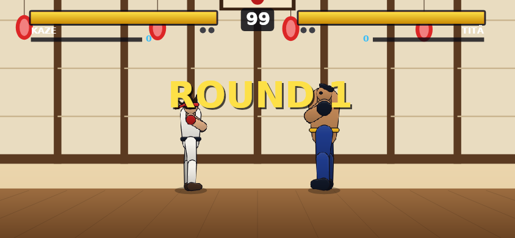
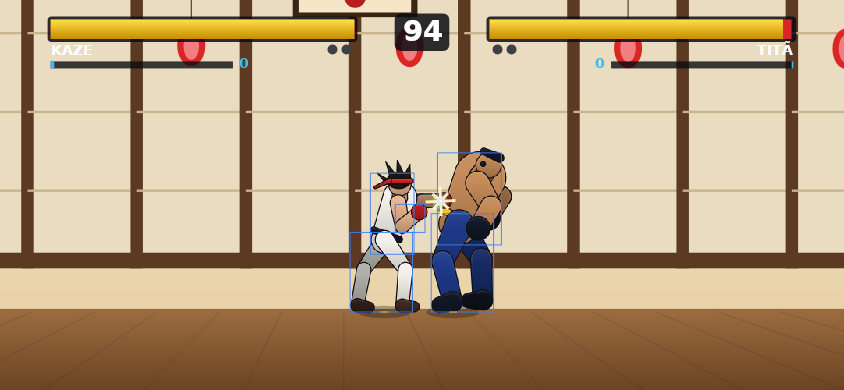
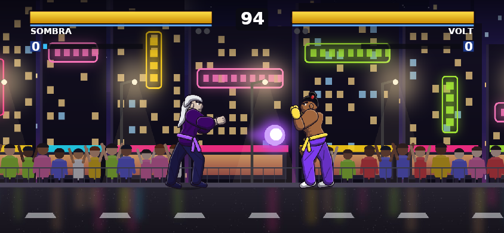
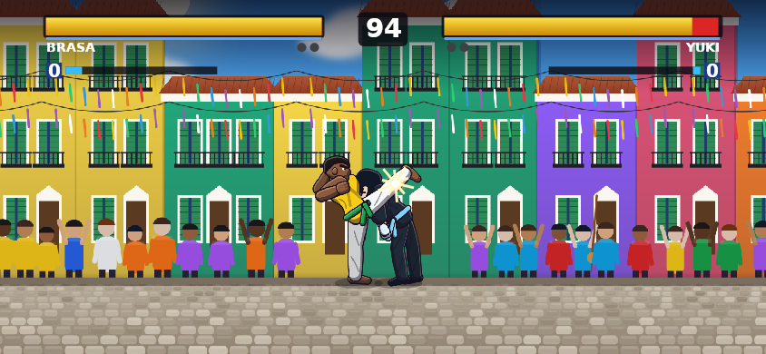
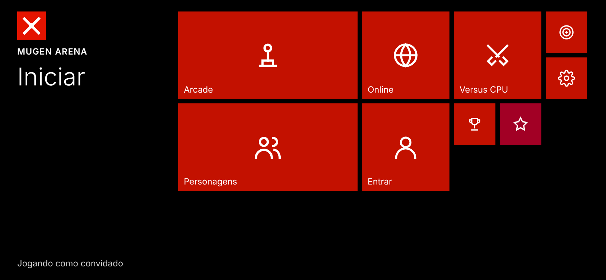
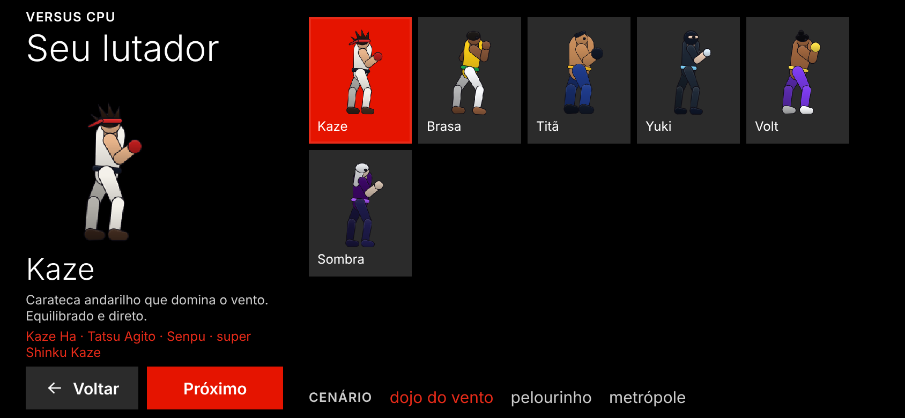
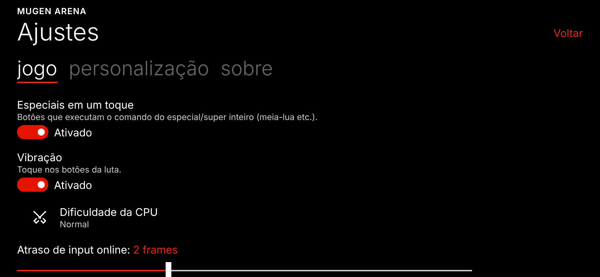
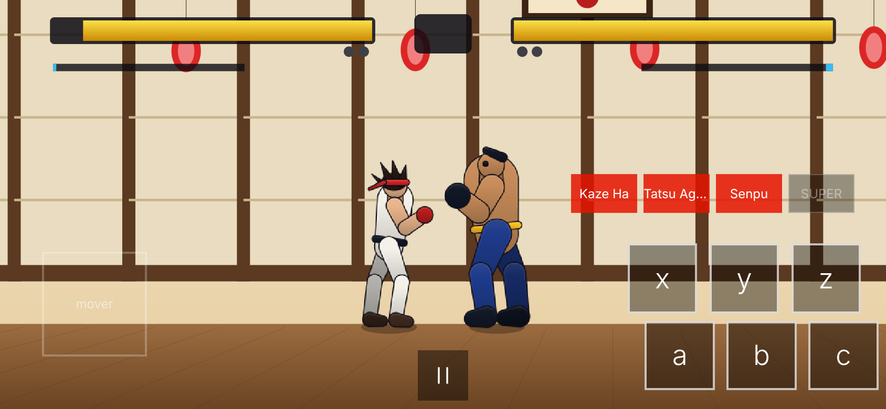

# MUGEN Arena

Jogo de luta 2D para **Android e iOS** (Expo / React Native) com engine própria
compatível com o formato de personagens do **MUGEN**, **luta online com rollback**,
**AdMob**, catálogo de **personagens baixáveis** e integração com os BFFs da CONEXUS
(`bff-auth`, `bff-payment`, `bff-api`).

| Intro | Golpe (treino, com caixas Clsn) | Projétil | Chute alto |
|---|---|---|---|
|  |  |  |  |

| Iniciar (W10M) | Seleção | Ajustes | Luta no app |
|---|---|---|---|
|  |  |  |  |

*Capturas geradas pelo próprio app: a luta pelo renderizador em Node (`npm run preview`, Skia/CanvasKit) e as
telas pelo app rodando no navegador (`npm run preview:web`, react-native-web + Playwright). Não substituem
teste em aparelho.*

## O que tem

- **Engine MUGEN em TypeScript** (`mobile/src/engine`): lê `.def`, `.air`, `.cmd` e `.cns`
  de verdade — estados, triggers com expressões, `HitDef`, `Projectile`, caixas Clsn1/Clsn2,
  comandos com `~ / $ >`, rounds, KO, tempo. 100% determinística (requisito do rollback).
  O MUGEN original (Elecbyte) é fechado e só roda no Windows; aqui reimplementamos o formato.
- **6 personagens originais** (sem IP de terceiros): Kaze, Brasa, Titã, Yuki, Volt e Sombra,
  cada um com 14 golpes normais, 3 especiais e 1 super, escritos no formato MUGEN
  (`mobile/characters/<id>/`) e com sprites gerados por um rig esquelético.
- **Adicionar personagens**: `npm run pack` converte uma pasta de personagem MUGEN
  (incluindo `.sff` v1/v2 e paleta `.act`) num pack e envia ao backend; após aprovação
  de um admin ele aparece no catálogo do app para download. Ver [docs/CHARACTERS.md](docs/CHARACTERS.md).
- **Modos**: Arcade (escada de oponentes, continue com anúncio premiado), Versus CPU,
  Treino (caixas de colisão, barra cheia) e Online (ranqueada por Elo ou sala com código).
- **Online**: netcode com rollback (input delay + predição + re-simulação + checksum
  anti-dessincronia) sobre ActionCable (Solid Cable, sem Redis).
- **Controles touch**: direcional flutuante, os 6 botões do MUGEN (x y z / a b c) e
  botões "assistidos" que executam especiais/super num toque.
- **AdMob**: banner nos menus, interstitial entre partidas (a cada 2, intervalo mínimo
  de 3 min), rewarded para continuar no arcade; consentimento UMP + ATT no iOS.
  Premium remove anúncios.
- **CONEXUS**: login PKCE no `bff-auth`, premium/checkout no `bff-payment`, e-mails
  (personagem enviado/aprovado) pelo `bff-api` via gem `conexus-platform`.

## Estrutura

```
mobile/    App Expo (Android/iOS) — engine, renderizador Skia, netcode, telas
  src/engine/        engine MUGEN determinística (+ testes)
  src/net/           ActionCable + rollback (+ testes)
  src/game/          renderizador, cenários, IA, macros de comando
  characters/        elenco nativo em formato MUGEN (.def/.air/.cmd/.cns + atlas)
  scripts/roster/    gerador do elenco (rig → sprites → arquivos MUGEN)
  scripts/mugen-pack.mjs  importador de personagens MUGEN (SFF v1/v2 → atlas)
web/       Rails 8 API — perfil, catálogo de personagens, matchmaking, relay online,
           webhooks CONEXUS, e-mails via bff-api
deploy/terraform/linode/  Terraform do LKE (módulo rails-lke do platform-infra)
docs/      PROTOCOL.md (contrato app ⇄ backend), CHARACTERS.md, screenshots
```

## Jogar agora (web)

`npm run play:build` (em `mobile/`) gera `mobile/play/dist`: uma versão web jogável com a **mesma engine,
personagens, IA e renderizador** do app (o desenho Skia passa por um adaptador para Canvas 2D). Arcade,
versus CPU e treino; teclado (setas/WASD, U I O socos, J K L chutes, 1–4 especiais/super) ou toque.
Não tem online, conta nem anúncios — isso é do app.

## Rodando

**App** (precisa de development build — AdMob e Skia são módulos nativos):

```bash
cd mobile
cp .env.example .env          # URLs dos BFFs, client_id OAuth, IDs AdMob
npm install
npm run test:all              # jest (engine, rollback, telas) + ferramentas + elenco + tsc
npx expo run:android          # ou: npx expo run:ios  /  eas build --profile development
```

**API Rails** (ver [web/README.md](web/README.md)):

```bash
cd web
cp .env.example .env
bundle install && bin/rails db:prepare
bin/dev                       # web + Solid Queue
bundle exec rspec             # 104 exemplos
```

## Stack

Mesma stack de app da frota (conexus-launcher, multi-miner), adaptada a jogo multiplataforma:

| Camada | Escolha |
|---|---|
| App | Expo / React Native (Android **e** iOS), expo-router, Skia (luta), Reanimated |
| Visual | **Design system W10M** (Windows 10 Mobile): tokens em `mobile/src/ui/`, componentes em `mobile/components/metro/` — ver [docs/W10M_DESIGN_SYSTEM.md](docs/W10M_DESIGN_SYSTEM.md) |
| Jogo | engine MUGEN determinística em TypeScript, rollback online, IA, macros de comando |
| Monetização | AdMob (UMP + ATT) e Premium no bff-payment |
| Servidor | Rails 8 API em `web/`, Solid Queue/Cable/Cache, Postgres compartilhado |
| Infra | `platform-infra` (workflows reutilizáveis, GHCR, Terraform LKE em `deploy/terraform/linode`), EAS |
| Processo | `AGENTS.md`, `HANDOFF.md`, `SKILL.md` + `agents/` + `templates/TASK.md`, `docs/UPDATE_X.Y.Z.md`, release por tag |

Versão atual: **0.1.0** — notas em [docs/UPDATE_0.1.0.md](docs/UPDATE_0.1.0.md).

## CI e deploy

Callers do [`platform-infra`](https://github.com/conexus-systems/platform-infra) em
`.github/workflows/` (layout produto Expo, só inputs — sem steps copiados):

| Workflow | Quando | O quê |
|---|---|---|
| `mobile-ci.yml` | PR/push em `mobile/**` | `ci-mobile.yml@v1`: typecheck, lint, `npm run test:ci`, `expo export` |
| `ci.yml` | manual / chamado pelo deploy | `ci-rails.yml@v1` em `web/` (RSpec, RuboCop, Brakeman) |
| `deploy-production.yml` | manual em `main` | testes → imagem GHCR (`web/Dockerfile`) → Terraform `deploy/terraform/linode` |
| `terraform-plan.yml` | manual | plan do mesmo Terraform |
| `eas-build.yml` | manual | build EAS Android (`preview`/`production`) |
| `github-release.yml` | tag `vX.Y.Z` | testes → APK pelo EAS → release no GitHub com SHA-256 e `docs/UPDATE_X.Y.Z.md` |

```bash
gh workflow run "Deploy — Production" --ref main
```

## Integração CONEXUS (resumo)

| BFF | Uso | Onde |
|---|---|---|
| `bff-auth` | Login OAuth2 + PKCE (cliente público), JWT RS256 verificado pelo backend via JWKS | `mobile/src/services/auth.ts`, `web/app/services/auth/` |
| `bff-payment` | `GET /v1/me/entitlements` (premium) e `POST /v1/me/checkouts` (checkout web); webhook `entitlement.changed` | `mobile/src/services/payments.ts`, `web/app/controllers/concerns/conexus_webhook_handler.rb` |
| `bff-api` | E-mails de personagem enviado/aprovado/recusado (`POST /webhooks/messages` assinado) | `web/app/services/notifications/conexus_messenger.rb` |

Cadastro necessário nos BFFs (feito por quem opera a plataforma) — ver
[web/README.md](web/README.md#registro-nos-bffs-conexus).

## Limitações conhecidas

- Compatibilidade MUGEN é um **subconjunto**: sem Helpers, Explods visuais, sons (.snd),
  arremessos com `p2stateno`/Target*, juggle points e cenários/screenpacks do MUGEN.
  Controladores não suportados são ignorados e listados ao carregar. Detalhes em
  [docs/CHARACTERS.md](docs/CHARACTERS.md).
- O app não foi executado em aparelho/emulador neste ambiente: a engine, o rollback,
  as ferramentas e o renderizador foram validados por testes e renders em Node; o backend
  por specs e um teste ponta a ponta de WebSocket. Falta um teste em device real
  (build EAS de desenvolvimento).
- Distribua apenas personagens que você tem direito de distribuir.
