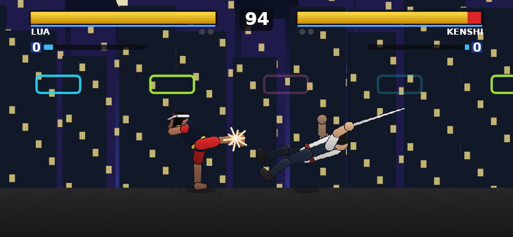
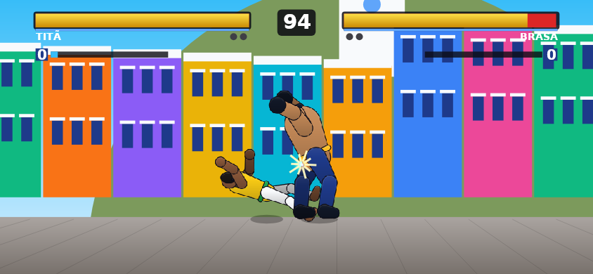
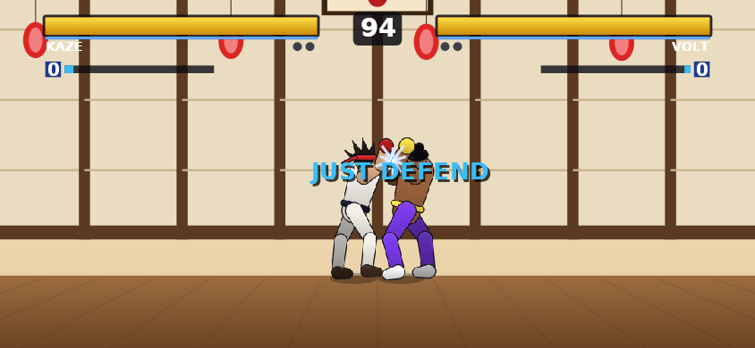

# MUGEN Arena 0.2.0 — sistema SNK

Pedido: "otimize e melhore pensando em todos os jogos de luta da SNK". O sistema de luta passa a seguir as
mecânicas de The King of Fighters, Garou e Samurai Shodown, por cima do formato MUGEN. Nenhum personagem,
nome ou arte da SNK foi usado: os personagens são originais.

| MAX + equipes | Blowback (C+D) | Arremesso para trás | Just Defend |
|---|---|---|---|
|  |  |  |  |

## Sistema de luta (`mobile/src/engine/snk.ts` + estados 6000+ no `common1`)

Botões no padrão SNK: **A** soco fraco, **B** chute fraco, **C** soco forte, **D** chute forte (no MUGEN:
x, a, z, c). O layout de 6 botões do MUGEN continua disponível em Ajustes.

| Entrada | O quê | Inspiração |
|---|---|---|
| tocar para cima | pulo curto (hop) | KOF |
| →→ / ←← | corrida e recuo | KOF |
| A+B | rolamento invencível (com ← para trás); atravessa o oponente | KOF |
| C+D (chão e ar) | blowback: derruba | KOF '98 |
| → ou ← + C/D colado | arremesso (para trás troca de lado); C ou D em até 10 frames escapa | KOF |
| A+B+C (1 estoque) | modo MAX por 10 s: +20% de dano, barra não enche | KOF '98 Advanced |
| super no MAX ou com vida ≤ 25% | super turbinado (+50% de dano, "MAX SUPER") | KOF '97/'98 |
| A+B / C+D defendendo (1 estoque) | guard cancel com rolamento ou blowback | KOF |
| ← no último instante (8 frames) | Just Defend: sem dano, recupera vida e sai antes da defesa | Garou |
| acertar quem está atacando | contra-ataque: +25% de dano e mais atordoamento ("COUNTER") | Garou / Samurai Shodown |
| defender demais | guard crush: a defesa quebra e o lutador fica aberto | KOF 2000 |
| barra de power | 3 estoques de 1000 que passam de um round para o outro | KOF '98 |

Também: K.O. em câmera lenta com clarão, "READY / GO!", "FINAL ROUND", "TIME UP", "PERFECT".

**Equipes 3×3** (novo modo no Iniciar do app e da versão web): eliminação estilo KOF. Quem vence continua
com a vida que tinha e recupera 30% do que perdeu; quem entra ganha 1 estoque.

Tudo é determinístico e mora no `WorldState`: vale igual no online com rollback (o online continua 1 contra
1). Personagens MUGEN importados também usam o sistema; quando não têm as animações novas, a engine usa
substitutas (ex.: 800 para arremesso, 240 para blowback).

## Conteúdo

- **Kenshi**: espadachim. O rig ganhou arma na mão da frente; os golpes de mão viram cortes com a lâmina
  (alcance maior). Kamaitachi (lâmina de vento), Iaigiri, Tsubame Gaeshi, super Mil Cortes.
- **Lua**: muay thai (Fortaleza). Joelhada Voadora, Cotovelada, Chute Tesoura, super Tempestade de Joelhos.
- Animações de sistema para os 8: rolamento, blowback no chão e no ar, arremesso, tonto (guard crush), MAX.
- Frases de vitória na tela de resultado.
- CPU usa o sistema: rola por cima de golpes, arremessa, escapa de arremesso, guard cancel, blowback, MAX,
  pulo curto.

## Controles

- App: 4 botões quadrados A B C D + atalhos A+B e C+D (padrão); botão MAX num toque; 6 botões em Ajustes.
- Web: A `U`, B `J`, C `I`, D `K`, A+B `O`, C+D `L`, MAX `M`; toque com o mesmo layout do app.

## Otimização

| Medida | Antes | Depois |
|---|---|---|
| Cenário no app (Skia) | centenas de chamadas JSI por frame (metrópole ≈ 1000 retângulos) | 1 `drawPicture` por camada parada; só lanternas, fitas e neon redesenhados |
| Paints do HUD | criados a cada frame | cor sólida e gradientes reaproveitados |
| `deepClone` (rollback) | 28% do tempo do benchmark | listas de números copiadas com `slice` |
| Animações substitutas | recriadas a cada consulta | guardadas fora do estado (sem afetar `AnimExist`) |
| Chamadas de desenho por frame na versão web | 418 / 593 / 1105 (dojo / pelourinho / metrópole) | 235 / 410 / 922 |

`npm run bench` (Node, 4 lutas CPU × CPU nível 3): simulação ≈ 0,013 ms por frame (> 900× tempo real),
rollback re-simulando 8 frames a cada frame ≈ 0,11 ms por frame (> 120× tempo real).

Na versão web as camadas gravadas são uma lista de comandos repetida a cada frame, não um bitmap:
no Chromium sem GPU deste ambiente, copiar um bitmap de tela inteira por camada ficou mais lento
(p50 de 25–40 ms contra 15–17 ms). Com a lista de comandos o tempo de frame ficou igual ao de antes
(p50 15–19 ms, mesmo Chromium). O ganho de verdade é no app (SkPicture nativa), e esse ganho **não foi
medido em aparelho**.

## Correção

- Versão web: os painéis com `display: grid` ignoravam o atributo `hidden`, e o "como jogar" ficava por cima
  do Iniciar e bloqueava os cliques. Agora `[hidden]` sempre esconde. O `index.html` também passou a declarar
  `utf-8`.

## Verificação (neste ambiente)

| Gate | Resultado |
|---|---|
| `npm run test:ci` | 104 testes jest + 6 das ferramentas + elenco atualizado. Novos: `snk.test.ts` com rolamento, cancelamento, blowback, arremesso e escape, prioridade do especial sobre o arremesso, Just Defend, MAX, contra-ataque, guard crush, guard cancel, hop, câmera lenta, equipes, determinismo com clone em 3×3. Também a seleção de equipes e os layouts de botões. |
| `npx tsc --noEmit` | sem erros |
| `npm run preview` | cenas SNK renderizadas com CanvasKit (acima) |
| Versão web + Playwright | Iniciar → Equipes → luta com rolamento, MAX e blowback por teclado, sem erros de script |

## Pendente

- Teste em aparelho (toque com 4 botões, desempenho do Skia com as SkPictures).
- Online em equipes (hoje o online é 1 contra 1).
- Balanceamento fino: os números (janelas, danos, custo da defesa) estão em `constants.ts` e `common1.ts`.
