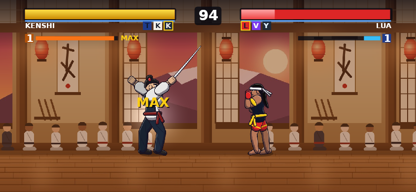
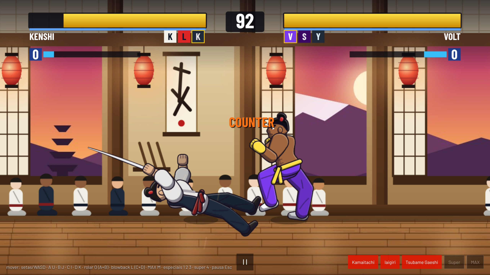
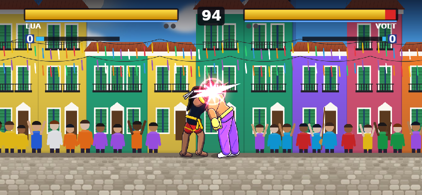

# MUGEN Arena 0.3.0 — arte nova

Pedido: "os bonecos e cenários estão muito ruins para ser um jogo". A arte inteira foi refeita, continuando
100% original e gerada pelo próprio repositório (sem assets de terceiros).

| Dojo | Pelourinho | Metrópole | Web |
|---|---|---|---|
|  |  |  |  |

## Lutadores (`scripts/roster/paint.mjs`)

O rasterizador próprio de cápsulas foi trocado por Skia (CanvasKit) em Node:

- membros com músculo em curvas de Bézier (deltoide, bíceps, antebraço, coxa, panturrilha);
- tronco com peito, cintura e quadril;
- sombreamento cel com a luz de cima e brilho na borda;
- contorno com espessura;
- rosto de perfil com orelha, olho, sobrancelha e boca, e cabelos redesenhados;
- roupas: gi com gola e mangas largas, calça com dobras, calção, faixa com nó e pontas, luvas com dedos, pés;
- katana com lâmina curva, tsuba e cabo trançado;
- projéteis com brilho desfocado.

Resolução dos sprites: de 2 para 3 pixels por unidade (atlas em 2–3 páginas). A respiração parada ganhou
quadros intermediários. Esqueleto, caixas de colisão e jogabilidade não mudaram.

## Cenários (`scripts/stages/paint-stages.mjs`)

Cada cenário virou 4–5 camadas pintadas com paralaxe (céu, fundo, meio, plateia, chão):

- **Dojo ao entardecer**: portas de shoji abertas para a montanha, lanternas acesas, pergaminho, alunos
  sentados em seiza assistindo, piso de madeira encerada com reflexos.
- **Pelourinho**: céu com nuvens, mar ao longe, igreja barroca azul no morro, casarões coloniais com
  sacadas e telhados, fitas do Bonfim, roda de capoeira com berimbau e plateia, calçamento pé-de-moleque.
- **Metrópole à noite**: estrelas e lua, skyline com neblina, prédios com neons brilhando, postes, plateia
  na grade, asfalto molhado com reflexos.

No jogo, cada camada é um `drawImageRect` por frame. Se as imagens não carregarem, vale o desenho
procedural antigo. A plateia balança. HUD com faixa escura no topo para ficar legível.

Tamanho: sprites ≈ 16 MB (eram ≈ 6 MB); cenários ≈ 1,1 MB.

## Verificação

- `npm run test:ci`: 104 testes jest + 6 das ferramentas + elenco atualizado.
- `npx tsc --noEmit`.
- `npm run preview`: capturas acima, renderizadas pelo renderizador do jogo com CanvasKit.
- Versão web no Chromium (Playwright): luta em equipes sem erros de script.
- Desempenho: no Chromium sem GPU deste ambiente, a versão web ficou em ~50 ms por frame. As camadas de
  tela inteira são ampliadas na CPU; antes eram ~16 ms. Com GPU (navegadores e celulares comuns) essa
  cópia é barata, mas isso **não foi medido**. No app, cada camada é uma imagem do Skia.
- Pendente: conferir em aparelho real.

## 0.3.1 — animação e impacto

- **Mais quadros por golpe** (≈ 40% a mais de sprites): quadros com 4 ticks ou mais, fora do acerto,
  ganham uma pose intermediária até a seguinte. O tempo de cada golpe e o instante do acerto não mudam;
  o gerador renumera `AnimElem` / `AnimElemTime` nos estados. Sprites a 2,6 px/unidade para manter o
  tamanho (≈ 19 MB).
- **Efeitos de impacto** (`src/game/effects.ts`):
  - clarão;
  - estrela de pontas;
  - rastro do golpe a partir dos médios;
  - onda de choque nos fortes;
  - faíscas com gravidade;
  - escudo azul em arco na defesa;
  - clarão branco em quem apanha;
  - poeira ao pousar, cair, correr e rolar.
- **Versão web**: resolução adaptativa. Se os frames ficam lentos (navegador sem GPU), o canvas cai de 2×
  para 1,5× e depois para 1×. No Chromium sem GPU deste ambiente, voltou a 60 fps (p50 16,7 ms).
