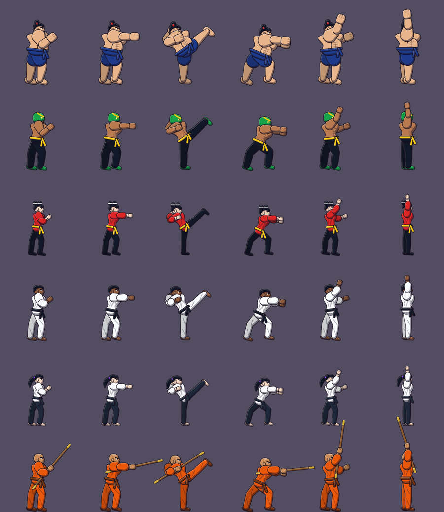
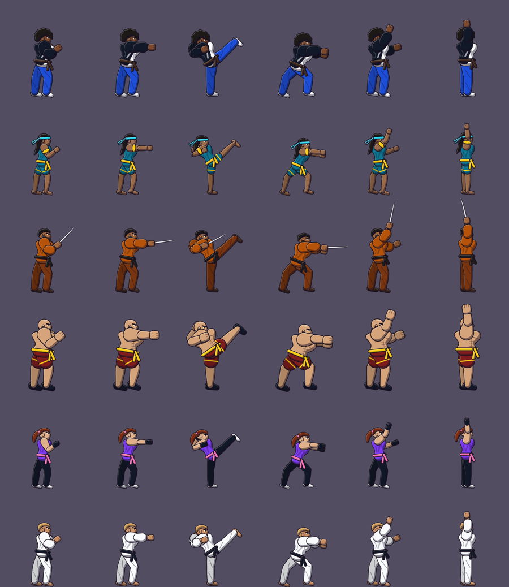
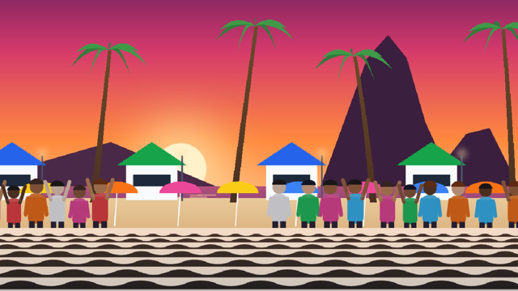
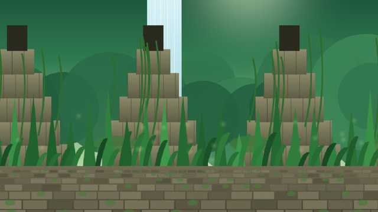
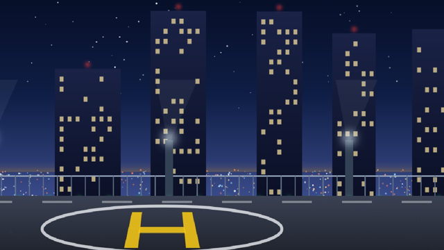
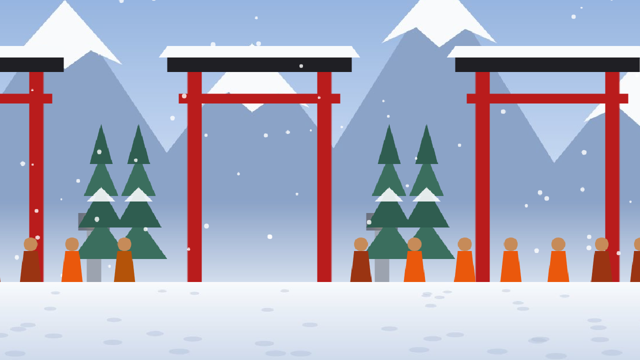
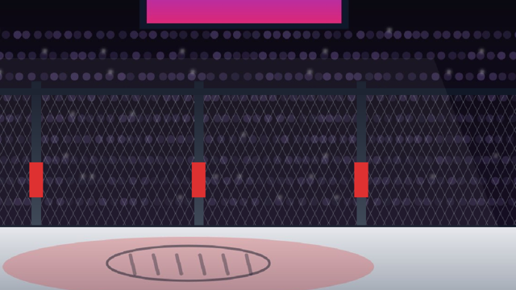

# MUGEN Arena 0.4.0 — versão "tunada"

Pedido: "uma versão bem tunada, cheia de personagens, fases e habilidades". A pesquisa sobre as versões do
MUGEN que existem está no fim deste documento. Decisão do dono do projeto: app publicado (só conteúdo
original ou com licença livre) e a engine própria mantida.

## Elenco: de 8 para 20 lutadores

| | |
|---|---|
|  |  |

**Novos:**

| Lutador | Estilo |
|---|---|
| Bento | Sumô (Liberdade, SP) |
| Jaguara | Lucha libre, mascarado |
| Mei | Kung fu, golpes de carga |
| Ícaro | Taekwondo |
| Akemi | Aikidô, contra-golpes |
| Tetsu | Monge do bastão |
| Zé Pilão | Brigão de rua (BH) |
| Iara | Guardiã dos rios da Amazônia |
| Severino | Vaqueiro do sertão com facão |
| Hércules | Luta greco-romana |
| Nadia | Savate |
| Kai | Jiu-jitsu (Floripa) |

O rig ganhou careca, black power, rabo de cavalo, coque duplo, barba, máscara de luchador, jaqueta,
barriga e bastão.

**Habilidades:**

- Todos têm **4 especiais e 2 supers**. O segundo super custa 2 estoques (`↓↙← ↓↙← + soco/chute`).
- **Especiais novos:**
  - agarrão de comando (imbloqueável, `←↙↓↘→ + botão`);
  - contra-golpe (postura invencível que revida);
  - golpes de carga (segurar ← ou ↓ e soltar);
  - projétil lançado do ar;
  - pisão com onda de choque rasteira;
  - rajada de golpes.
- Os 8 antigos ganharam o 4º especial e o super de 2 estoques.
- A CPU usa agarrões, cargas e o super de 2 estoques.

## Cenários: de 3 para 8

| Praia ao entardecer | Ruínas da Amazônia | Heliponto | Templo na neve | Octógono |
|---|---|---|---|---|
|  |  |  |  |  |

## Som (novo; antes o jogo era mudo)

`src/audio/synth.ts` gera tudo por código, sem arquivos de terceiros:

- **18 efeitos:** golpe fraco, médio e forte, defesa, deslocamento de ar, pulo, pouso, projétil, super, MAX,
  K.O., gongo do round, "lute", contra-ataque, Just Defend, guard crush, agarrão e escape.
- **Uma trilha por cenário** (16 compassos em laço, com bateria, baixo, acordes e melodia), cada uma no clima
  do lugar: taiko no dojo, berimbau e agogô no Pelourinho, synthwave na metrópole, bossa na praia,
  drum & bass no heliponto etc.

Como toca:

- **App:** expo-audio, com WAV no cache.
- **Web:** WebAudio.
- **Ajustes:** Música e Efeitos sonoros, separados. Na web, a tecla N liga e desliga.

## Compatibilidade MUGEN (personagens importados)

- **Arremessos do MUGEN:**
  - `HitDef p2stateno`/`p2facing` e estados personalizados (o oponente roda os estados do atacante);
  - `ChangeAnim2` (animações do atacante, desenhadas com o atlas dele);
  - `SelfState`;
  - `TargetState`, `TargetBind`, `BindToTarget`, `TargetLifeAdd`, `TargetFacing`, `TargetVelSet/Add`,
    `TargetPowerAdd` e `TargetDrop`, além do trigger `NumTarget`.
- **Helper** (entidade própria que ataca e se move):
  - `DestroySelf`, `BindToParent/Root` e `ParentVarSet/Add`;
  - redirecionamentos `parent`, `root` e `helper(id)`;
  - triggers `NumHelper` e `IsHelper`.
- **Explod:** `postype`, `bindtime`, `vel/accel`, `removetime`, `scale`, `ontop`, `removeongethit` e
  `trans = add`. Também `RemoveExplod`, `ModifyExplod` e `NumExplod`.
- **Sons:**
  - `PlaySnd`, `hitsound` e `guardsound`;
  - `npm run pack` converte o `.snd` e leva só os sons usados (até 4 MB; `--no-sound` desliga);
  - os sons comuns (`F`) usam os efeitos do jogo.
- **Correções da engine:**
  - a pausa de super congelava o mundo, mas a animação de quem soltou continuava, e os primeiros golpes do
    super se perdiam;
  - o comando estrito `>` não era respeitado (a dupla meia-lua para trás disparava o recuo `B, B`);
  - `hitflag = M-` era lido como expressão.

## Tamanho

Os atlas passaram de PNG para **WebP**: 20 lutadores em ≈ 19 MB (eram 46 MB em PNG). Os cenários somam
≈ 2 MB.

## Verificação

- `npm run test:ci`: 138 testes jest e 7 das ferramentas, com o elenco atualizado. Os testes novos cobrem:
  - os 20 personagens;
  - agarrão que passa pela defesa;
  - golpe de carga pela macro;
  - contra-golpe;
  - super de 2 estoques;
  - projétil aéreo e pisão;
  - um personagem MUGEN sintético com arremesso por `p2stateno`, ChangeAnim2, TargetBind, TargetLifeAdd e
    TargetState;
  - Helper que ataca e se destrói;
  - Explod com `removetime`;
  - PlaySnd;
  - clone para o rollback com helpers e explods;
  - leitura do `.snd`.
- `npx tsc --noEmit`; `npx expo export --platform android`.
- Versão web no Chromium (Playwright): luta sem erros de script, música em laço e efeitos tocando.
- **Pendente:**
  - ouvir o som num aparelho (aqui só deu para conferir a forma de onda e o espectrograma);
  - testar em aparelho real;
  - balancear os 20 lutadores.

## Pesquisa: versões do MUGEN que existem

- **MUGEN 1.1 (Elecbyte):** fechado, só Windows, uso **não comercial**. Não serve para um app com anúncios.
- **Ikemen GO:** open source (MIT), compatível com o MUGEN 1.1, com builds para Windows, macOS, Linux,
  Android 13 e iOS 17 (sideload), rollback na versão de desenvolvimento. É a base livre mais completa.
- **Coleções "full game":** KOF Anthology (≈670 personagens), MUGEN Hyper Edition, EVE All-Stars e outras
  são quase todas de sprites extraídos de jogos comerciais (SNK, Capcom, Toei). Não podem ir para a loja.
  Por isso o app mantém o caminho de importar packs que o próprio jogador tem direito de usar.
