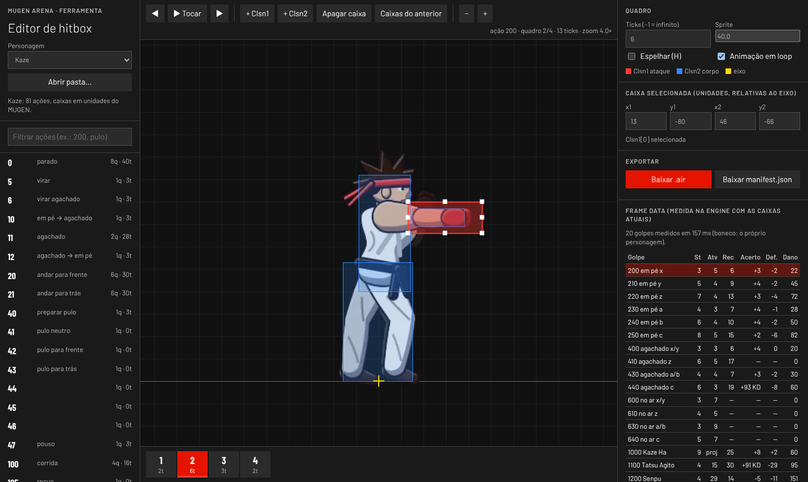
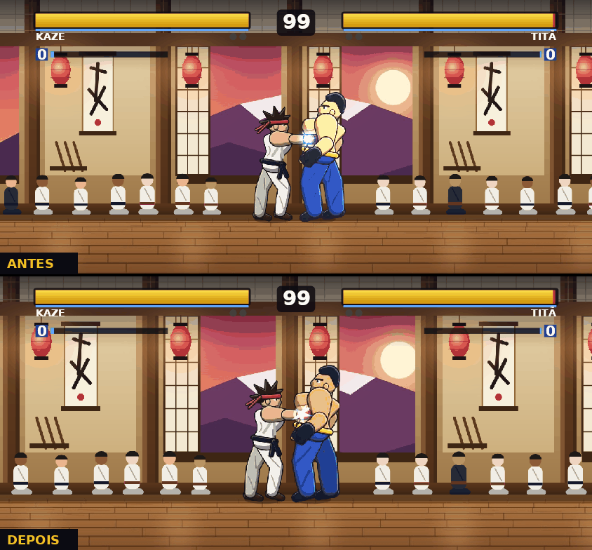
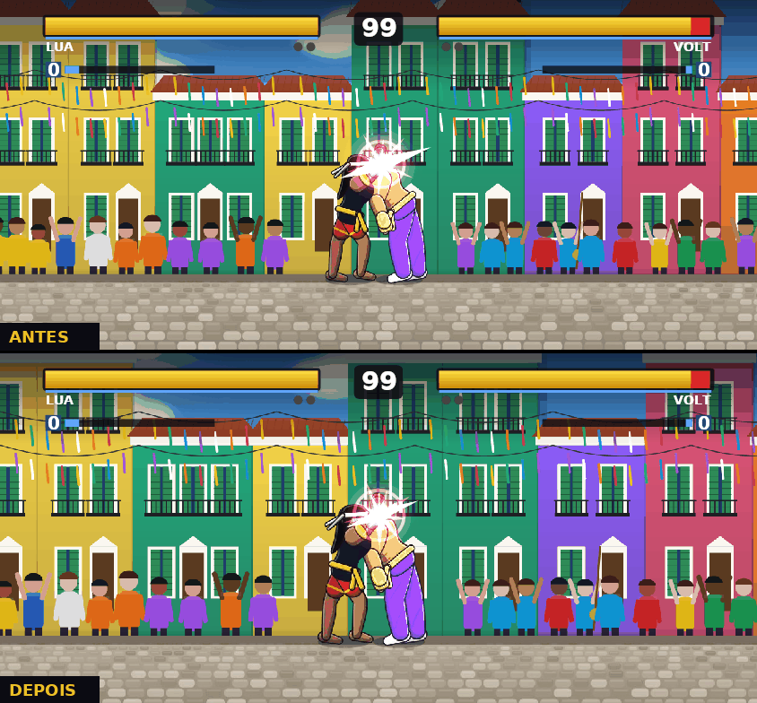
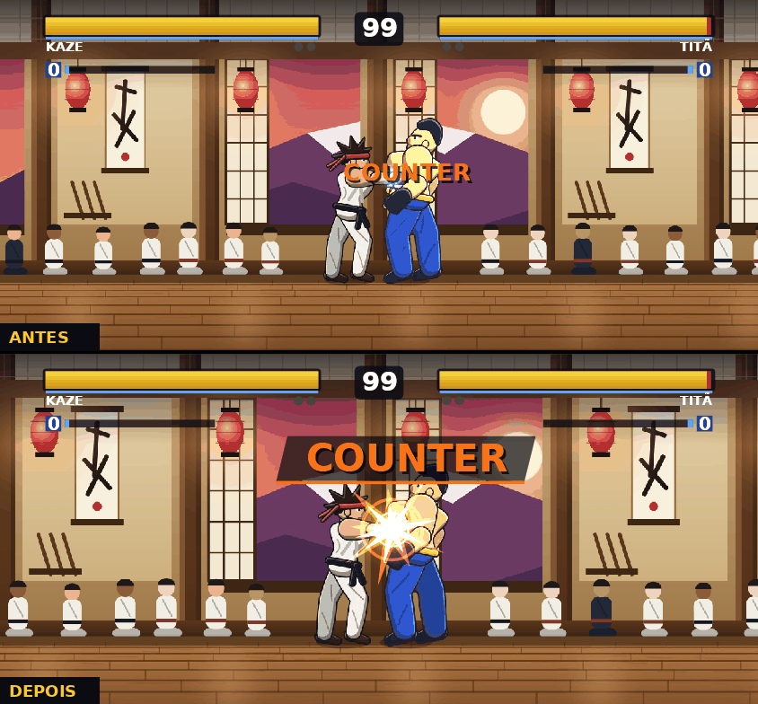
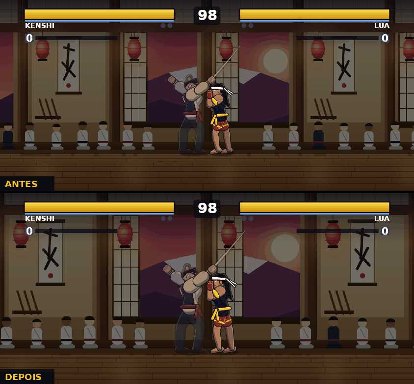
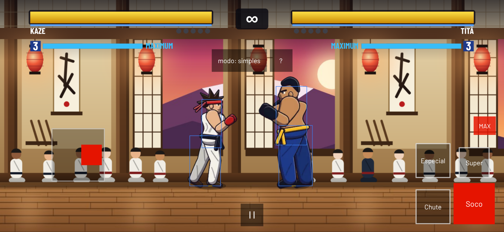

# MUGEN Arena 0.5.0 — fundação do jogo comercial

Pedido: transformar o protótipo num jogo comercial, seguindo o roadmap (Fases 0 a 3), e vender o app por
R$ 50 na Google Play. Esta versão entrega a parte de código e de planejamento; a arte final depende de
contratação (ver "Pendente").

## Modelo de negócio: jogo pago

- **Compra única na Google Play** (R$ 49,99, configurado no Play Console). Sem anúncios, sem assinatura,
  sem compras dentro do app.
- Saíram do app: AdMob, App Tracking Transparency, paywall e assinatura Premium (bff-payment). O
  Android bloqueia a permissão `AD_ID`. "Continuar" no arcade é livre.
- Personagens do catálogo da comunidade que eram "premium" ficam livres para todos.
- **Licença para o online**: fila ranqueada e salas exigem cópia comprada na Google Play, comprovada pelo
  Play Integrity (`@expo/app-integrity`). O servidor confere o veredito no Google (app reconhecido,
  licenciado, aparelho íntegro) e libera por 7 dias (`/api/v1/license/challenge` e `/verify`,
  `players.licensed_until`). Ligado por `PLAY_INTEGRITY_REQUIRED=1`. **O modo offline nunca depende
  de licença.** No iOS não há checagem (App Attest não prova compra).

## Planejamento (docs/)

- `docs/ROADMAP.md`, `docs/gdd/GDD.md`, `docs/gdd/ELENCO_LANCAMENTO.md` (8 lutadores de lançamento; fatia
  vertical com Kaze e Brasa no Pelourinho), `docs/art/BRIEF_TESTES_DE_ESTILO.md` (encomenda dos testes de
  arte), `docs/brand/NOMES.md` (BAMBA, EMBATE, GINGA; marca não verificada) e `docs/backlog/` (épicos das
  Fases 0 a 3).

## Ferramentas de produção

| Comando | O que faz |
|---|---|
| `npm run framedata` | Simula cada golpe na engine e gera `docs/framedata/` (20 lutadores, 400 golpes): startup, ativos, recuperação, vantagem no acerto e na defesa, dano, nível, barra |
| `npm run import-sprites -- <pasta>` | PNGs + `manifest.json` → atlas WebP + AIR + pacote do personagem; serve para 3D pré-renderizado e pixel art (`docs/SPRITE_PIPELINE.md`) |
| `npm run editor` | Editor web de hitbox: quadro a quadro, arrastar caixas, frame data recalculada na hora, exporta AIR/manifest |

## Sensação de impacto (`docs/GAME_FEEL.md`)

- Pausa no impacto por intensidade (fraco 8 → super 17 quadros; defesa 60%; contra-ataque +5; K.O.).
- Câmera: segue com suavização, zoom pela distância, "punch" e tremor nos golpes fortes; respeita
  "Reduzir movimento" (novo ajuste).
- Efeitos por intensidade, escudo de defesa, guard crush estilhaçando, "COUNTER" novo; teto de 96
  partículas.
- Buffer de 5 quadros para especiais e supers, congelado durante o impacto; super > especial > normal no
  mesmo quadro.

| Fraco | Forte | Contra-ataque | Super |
|---|---|---|---|
|  |  |  |  |

## Controles touch (`docs/CONTROLS.md`)

- **Modo simples** (padrão em instalação nova): botão Especial + direção solta os especiais, Super com
  barra, toques no Soco fazem um combo curto do personagem. Vira entrada normal antes da engine, então o
  online continua determinístico.
- **Modo clássico**: direcional flutuante ou fixo, zona morta ajustável, 8 direções com folga para a
  diagonal não escorregar.
- Editor de layout (arrastar, tamanho, opacidade), vibração nos acertos, gamepad na versão web.

## Online (`docs/ONLINE.md`)

- Mesmo resultado em qualquer aparelho: a engine não usa mais `sin/cos/exp/pow` do JavaScript (que
  variam entre o Hermes do celular e o V8); um teste falha se voltarem.
- `npm run soak -- 1000`: 1.000 partidas simuladas em 4 perfis de rede (wi-fi a quedas de 1–8 s):
  **0 dessincronias, 0 partidas travadas**; volta ao jogo em 117 ms em média depois de reconectar.
- O soak achou e corrigiu um travamento real: o ajuste de ritmo entre os jogadores congelava a partida
  quando uma mensagem se perdia.
- Reconexão em até 10 s; depois, derrota por abandono.
- Ranqueada com Glicko-2, temporadas de 8 semanas, ligas de Bronze a Mestre; fila abre a faixa de nível
  com a espera.
- Antitrapaça básica: checksums e hash das entradas comparados no servidor; divergência anula a partida e
  vai para revisão; replays guardados 30 dias.

## Desempenho e telemetria (`docs/DEVICE_LAB.md`)

- Telemetria só com consentimento, sem dados pessoais, apagada em 90 dias.
- Registro de travamentos do app, enviado na abertura seguinte (com consentimento).
- Indicador de fps/tempo de quadro (build de dev, ou 7 toques na versão em Ajustes).
- Modo de teste de desempenho (luta CPU × CPU de 60 s) no app e na web (`?bench=1`).
- `npm run size` com limite de tamanho; workflow `mobile-budget.yml` mede tamanho e desempenho.

## Correções

- Agarrões de meia-volta do Titã, da Lua e do Zé nunca saíam (a meia-lua do mesmo botão vencia). O
  gerador agora confere os movimentos mais longos primeiro.
- HitDef num quadro de duração infinita rearmava a cada acerto (o pisão do Bento acertava 18 vezes, 508 de
  dano; agora 2 acertos, 125).

## Verificação

- `npm run test:ci`: 242 testes jest, 11 testes das ferramentas, elenco atualizado.
- `npx tsc --noEmit` sem erros; `npx expo export --platform android` ok.
- Web: `bundle exec rspec` 158 exemplos sem falha, `rubocop` e `brakeman` limpos.
- Números medidos em contêiner sem GPU (não valem como celular): simulação 0,017 ms por quadro; versão web
  com 51 fps médios em Chromium sem GPU; export Android de 26,7 MB.

## Pendente

- **Arte final** (o maior gargalo): escolher o estilo, contratar diretor de arte, designer de combate e
  estúdio, encomendar os testes de estilo.
- **Nome e marca** antes de publicar (o identificador do app não muda depois).
- **Aparelho real**: nada foi testado em celular; roteiro em `docs/DEVICE_LAB.md`.
- **Play Console**: preço, conta de serviço do Play Integrity (`PLAY_INTEGRITY_SERVICE_ACCOUNT`),
  `EXPO_PUBLIC_PLAY_CLOUD_PROJECT` no EAS, teste com licenças de teste na faixa interna.
- Infra: levar as variáveis novas para o Terraform; partida online real entre celular e navegador.
